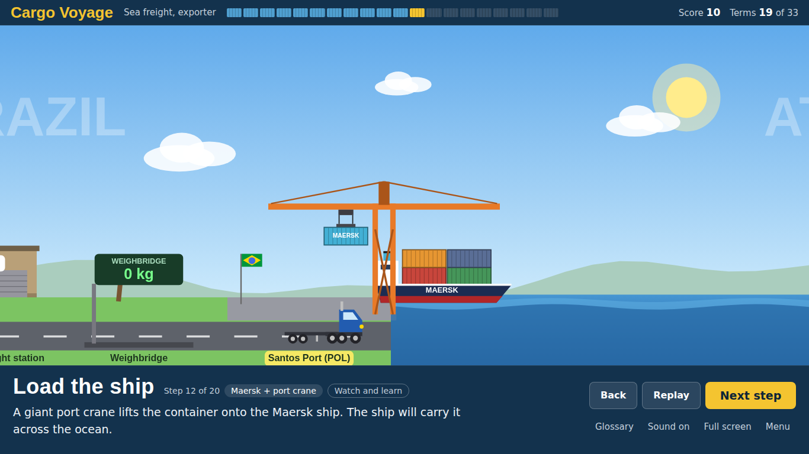
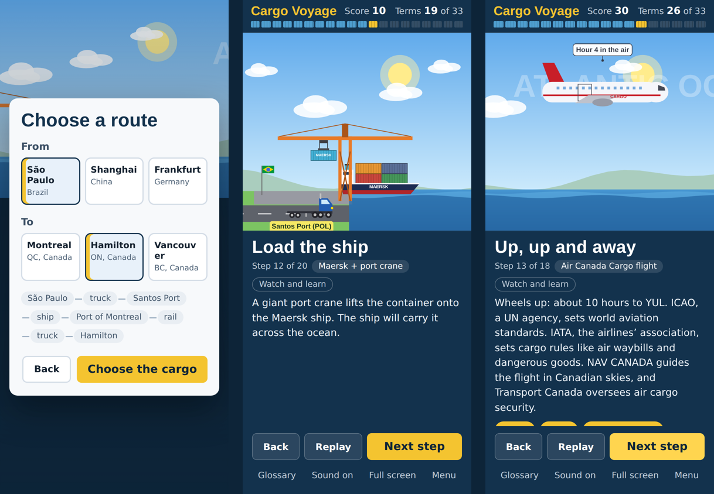

# Cargo Voyage

**Follow one shipment into Canada, step by step.** Pick sea or air freight, choose a side (exporter or importer), a route and a product, then play through every stage of the move: the paperwork, the people, and the trucks, ships, trains and planes that carry it.

**[Play it in your browser](https://markfourman.github.io/cargo-voyage/)** — works on desktop and phone, no install.






## What it teaches

Built from my class notes in Global Logistics (Supply Chain Management, Seneca College), it turns the import/export process into an animated walkthrough with quizzes.

- **Sea freight:** freight forwarders, booking the carrier, FCL vs LCL (with consolidation at a container freight station), straight trucks, chassis and trucking services, the verified gross mass (VGM) under SOLAS, port of loading and port of discharge, export customs, master and house bills of lading, the e-manifest, IMO rules (SOLAS, COLREG, IMDG), and intermodal rail.
- **Air freight:** booking through a general sales agent (GSA), chargeable weight, choosing a ULD (PMC pallet or AKE container), security screening and build-up by the ground handler, master and house air waybills (MAWB/HAWB), ACI e-manifest timing, K-loaders, ICAO, IATA, NAV CANADA and Transport Canada, and sufferance warehouses.
- **Import into Canada:** customs brokers, the Canada Customs Invoice (CCI), the Commercial Accounting Declaration (CAD) filed through CARM, CBSA release and, for food, CFIA inspection.
- **Products change the lesson:** laptops bring dangerous-goods rules (lithium batteries, Class 9), fresh mangoes need a reefer and cool chain, and furniture shows why bulky cargo is priced by volume.

That's 2 modes × 2 roles × 9 routes × 4 products × 2 choices, with 30+ glossary terms per route and quizzes along the way.

## How it's built

- **No frameworks, no build step.** Plain HTML, CSS and JavaScript. Open `index.html` and it runs.
- **Lessons are data, not code.** Each step is written as a short script of timed actions ("this truck drives to the port between 10% and 60% of the step", "this document flies to the broker"). Adding a step doesn't touch the drawing or engine code.
- **A replay engine instead of saved state.** To show any moment, the engine rebuilds the world from scratch: it plays every earlier step to its end, then the current step up to now. Back, Replay and changing a decision can't leave a truck or container in the wrong place.
- **Canvas for the world, HTML for the words.** The animation is drawn on a canvas that scales to any screen, with sharper detail on high-density phone displays. Text, buttons, quizzes and the glossary are real HTML, so they stay readable, work with screen readers and resize properly.
- **Three layouts:** desktop, phone upright and phone sideways. Swipe the scene to change steps on touch screens; use the arrow keys on a keyboard.
- **Automated self-test.** `tests/selftest.js` builds all 432 combinations of mode, role, route, product and choice, checks the lesson data for mistakes, and renders about 58,000 animation frames on a strict fake canvas that fails on any invalid coordinate. It runs on every push with GitHub Actions.

## Run it

**On your computer:** download the repository and double-click `index.html`.

**Run the self-test** (needs [Node.js](https://nodejs.org)):

```
node tests/selftest.js
```


## Project layout

| File | What it does |
| --- | --- |
| `js/content.js` | Routes, products and the glossary. Add a route or product here. |
| `js/lessons.js` | Every sea and air step: narration, terms, animation script, quizzes. |
| `js/builder.js` | Lays out the world for the chosen route and provides the helpers lessons are written with. |
| `js/engine.js` | The replay engine, plus a validator that catches lesson mistakes. |
| `js/render.js` | Draws the world: ports, cranes, ships, planes, trains, trucks and documents. |
| `js/audio.js` | Sound effects, synthesized in the browser (no audio files). |
| `js/app.js` | Menus, the lesson panel, quizzes, camera, touch and keyboard input. |
| `tests/selftest.js` | Plays every combination and checks it. |

## Notes

- Everything is simplified for teaching and the map isn't to scale. Transit times are approximate, and regulations change, so check official sources (CBSA, IMO, IATA) before relying on any detail.
- Company and agency names (Maersk, COSCO, Hapag-Lloyd, Air Canada Cargo, CPKC, CBSA and others) are used only to illustrate real-world roles. This project isn't affiliated with or endorsed by any of them.

## License

MIT. Built by Mark Fourmanovskis.
